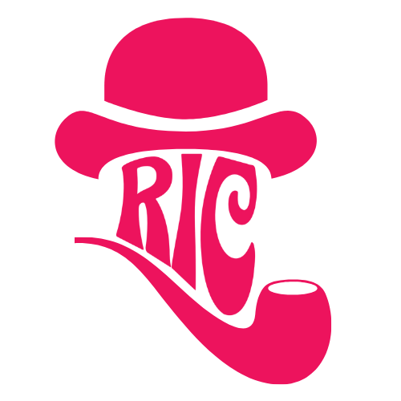
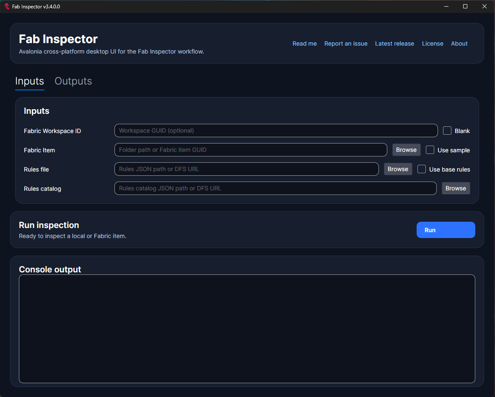

[](https://github.com/NatVanG/fab-inspector/actions/workflows/github-code-scanning/codeql)
[](https://github.com/NatVanG/fab-inspector/actions/workflows/tests.yml)
[](https://github.com/NatVanG/fab-inspector/actions/workflows/docker-publish.yml)

# Fab Inspector

## Deterministic rules-based testing for Microsoft Fabric in the age of AI

Meet Ric, the Fab Inspector.

<div style="display: flex; gap: 20px; align-items: center;">
  
  
</div>

## Note

This is a community project and is not supported by Microsoft.

Power BI report testing supports enhanced metadata format (PBIR). PBIX files are not currently supported; use PBIP or `{my-report}.Report` folders.

## What It Does

Fab Inspector validates Fabric artifacts with declarative JSON rules. You can run the same rules:

- Locally against checked-out item definitions
- In CI/CD pipelines (ADO or GitHub log formats)
- Against published Fabric workspace items with authentication

Beyond artifact structure, Fab Inspector can also inspect:

- **Tenant and capacity configurations** — validate tenant posture against your governance policies through API operators
- **Data-based checks** — use DAX query and T-SQL query operators as rule conditions to enforce data quality, semantic model correctness, and lakehouse health

Outputs can be written as Console, JSON, HTML, ADO, or GitHub formats or combined e.g. "GitHub,JSON"

## Quick Start

### Desktop GUI (Avalonia)



The cross-platform `FabInspector.AvaloniaUI` desktop application lets you run inspections without the CLI. Point it at a local Fabric item folder or a Fabric workspace, choose a rules file and output format, and click **Run**. Results are written to a local folder or directly to OneLake, and can auto-open in the browser as HTML. See the [GUI Reference](docs/gui-reference.md) for a full walkthrough.

### CLI

Local mode:

```bash
fab-inspector -fabricitem "C:\Files\Sales.Report" -rules ".\Files\Base-rules.json" -formats Console
```

Workspace mode (with interactive auth):

```bash
fab-inspector -fabricworkspace "<workspace-guid>" -rules ".\Files\Base-rules.json" -authmethod interactive -formats Console
```

Workspace mode scoped to a Fabric item (with azurecli auth):

```bash
fab-inspector -fabricworkspace "<workspace-guid>" -fabricitem "<item-guid>" -rules ".\Files\Base-rules.json" -authmethod azurecli -formats Console
```

Show all CLI options:

```bash
fab-inspector -help
```
## Releases

Release binaries for the CLI and GUI are published at: https://github.com/NatVanG/fab-inspector/releases

**Maintainers:** Before creating release tags, update `FabInspectorVersionPrefix` in `Directory.Build.props` and commit the change.
The following PowerShell commands read that version and create signed tags on the current commit:

```powershell
$version = ([xml](Get-Content -Raw .\Directory.Build.props)).Project.PropertyGroup.FabInspectorVersionPrefix.InnerText.Trim()

git tag -s "v$version" -m "Release CLI v$version"
git tag -s "v$version-AvaloniaUI" -m "Release Avalonia UI v$version"
git tag -s "v$version-Winform" -m "Release WinForm v$version"
```

Verify the tags, then push each tag to `origin`:

```powershell
git tag --verify "v$version"
git tag --verify "v$version-AvaloniaUI"
git tag --verify "v$version-Winform"

git push origin "v$version"
git push origin "v$version-AvaloniaUI"
git push origin "v$version-Winform"
```

The tag formats are case-sensitive and must match the release workflows:

| Application | Tag format |
|---|---|
| CLI | `v<version>` |
| Avalonia UI | `v<version>-AvaloniaUI` |
| WinForm | `v<version>-Winform` |

Pushing each signed tag triggers its corresponding `*-release.yml` workflow. The workflows derive the application
version from the tag; the CLI tag does not include a suffix.

### CLI Docker image

Use a version tag for a specific CLI release once it has been published, or use `latest` to follow the maintainer-selected version:

```bash
docker pull ghcr.io/natvang/fab-inspector:vX.Y.Z  # Replace vX.Y.Z with a published version tag.
docker pull ghcr.io/natvang/fab-inspector:latest
```

For exact image identity in CI, pin the registry digest (`ghcr.io/natvang/fab-inspector@sha256:<digest>`).

**Maintainers:** In **Actions → Build and Publish Docker Image → Run workflow**, select the default branch and enter the CLI Git tag as `version`:

- `publish` builds that tag and publishes its versioned image without changing `latest`. It won't overwrite an existing version tag. Only Git tags that include Docker CLI version support can be published by this workflow.
- `promote` points `latest` to the already-published version without rebuilding. To roll back, promote an older published version.

## Documentation

| Document | Description |
|---|---|
| [Intro](docs/intro.md) | Conceptual overview of Fab Inspector and why declarative JSON rules matter |
| [Agentic Development](docs/agentic-development.md) | Rule discovery, prompt conflict handling, and agent-orchestrated inspection of Fabric items |
| [Usage Scenarios](docs/usage-scenarios.md) | Common local, CI/CD, workspace, and hybrid validation patterns |
| [GUI Reference](docs/gui-reference.md) | Cross-platform Avalonia desktop application walkthrough |
| [CLI Reference](docs/cli-reference.md) | Full CLI parameters, auth options, and command examples |
| [Rules Guide](docs/rules-guide.md) | Rule schema and test logic |
| [Operators Overview](docs/operators-overview.md) | When to use Ric vs FabInspector operators |
| [Examples Index](docs/examples-index.md) | Catalog of rule files in ExampleRules by use case |
| [Ric Operators](docs/Ric-Operators.md) | Local/query/transformation/file-system operators |
| [FabInspector Operators](docs/FabInspector-Operators.md) | API, DAX, SQL, and DFS operators |
| [Architecture](FabInspector.Core/Architecture.md) | Inspection engine and DI/concurrency internals |

## Base Rules

Fab Inspector ships with base rules at [Rules/Base-rules.json](Rules/Base-rules.json), focused on report visual quality checks.

To customize:

1. Copy the base rules file.
2. Edit parameter values or set `"disabled": true` on unwanted rules.
3. Point `-rules` to your customized file.

## Agentic Fabric development

Fab Inspector provides guardrails for development agents creating Microsoft Fabric items, for example when using the Fabric-skills plugin. Run the CLI as a stdio MCP server:

```bash
fab-inspector serve
```

Before creating items, the development agent calls `discover_rules` for the relevant Fabric item types and configured rules. The agent interprets the returned rule metadata to guide creation and alerts the user if the development prompt contradicts those rules. After creation, it calls `inspect` to execute the rules against the actual items, uses the returned results to correct failures, and repeats inspection as needed.

**The development agent orchestrates this workflow.** Fab Inspector provides discovery and inspection; it does not create Fabric items, resolve prompt conflicts, or automatically run an agent's correction loop.

See [Agentic Development](docs/agentic-development.md) for the workflow diagram, MCP examples, and suggested agent instructions.

## Agentic rule creation

The creation of rules for Fab Inspector can feel unfamiliar, luckily an AI agent is available via this repo: https://github.com/NatVanG/fab-inspector-test-harness/blob/main/README.md. This capability is being actively developed and improved, always review AI generated output for accuracy. 

## CI/CD

Fab Inspector supports CI/CD pipeline integration:

- `-formats ADO` for Azure DevOps task commands
- `-formats GitHub` for GitHub Actions annotations/logging

Tutorial and sample links are documented in [CLI Reference](docs/cli-reference.md).

## Wiki

For deep-dive guidance and advanced operator/rule examples, see the [Fab Inspector wiki](https://github.com/NatVanG/fab-inspector/wiki).

## Thanks

Thanks to [Michael Kovalsky](https://github.com/m-kovalsky), [Rui Romano](https://github.com/ruiromano), [Luke Young](https://www.linkedin.com/in/luke-young-2301/), and [David Mitchell](https://www.linkedin.com/in/davidmitchell85) for support and feedback.

## Report an Issue

Please report issues at https://github.com/NatVanG/fab-inspector/issues.
