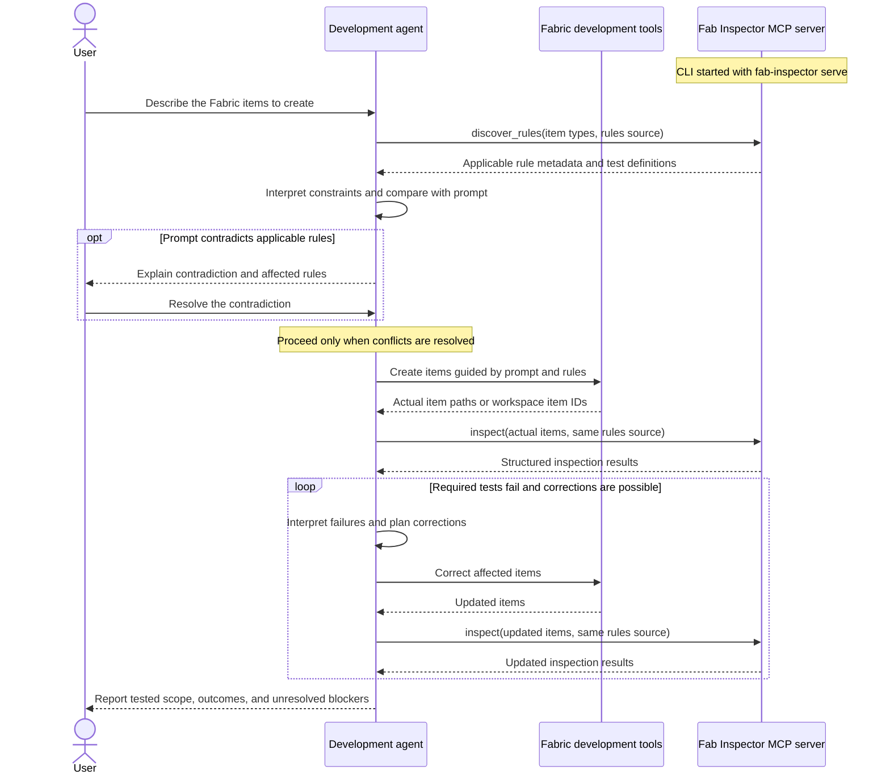

# Agentic Fabric development with Fab Inspector

Fab Inspector supports the Microsoft Fabric agentic development flow by making team rules available before item creation and executing those rules after creation. A development agent can use these guardrails alongside the Fabric-skills plugin or other Fabric development capabilities.

**The development agent must orchestrate the workflow.** The CLI provides rule discovery and inspection through MCP; it does not create Fabric items, interpret the user's intent, decide how to resolve contradictions, or automatically trigger corrective iterations. Using a plugin alone does not establish this workflow: the agent needs access to the MCP server and instructions to use it.

## Responsibilities

| Component | Role |
|---|---|
| User | Supplies the development prompt and resolves conflicts between requested behavior and applicable rules. |
| Development agent | Identifies item types, discovers and interprets rules, highlights contradictions, creates or edits items using its development tools, and coordinates inspection and corrections. |
| Fabric-skills plugin or other development capabilities | Supplies Fabric development guidance or capabilities the agent uses when creating or changing items. This guide does not assume a particular client or plugin setup. |
| Fab Inspector MCP server | Returns applicable rule metadata through `discover_rules` and executes rules through `inspect`, returning structured JSON results. |

Discovery provides planning context, not a validation result. Inspection tests the actual artifacts; neither tool replaces the development agent.

## Connect the CLI as an MCP server

Install the Fab Inspector CLI from the [release instructions](../README.md#releases). Configure your agent's MCP client to launch the installed executable with `serve` as its argument:

```bash
fab-inspector serve
```

The server uses stdio transport. The client must be able to launch the executable and access the paths supplied in tool calls. Supply rules, targets, and authentication through tool arguments; starting the server does not select rules or begin an inspection.

Each tool call requires exactly one of `rules` (a rules JSON file) or `rulesCatalogPath` (a catalog referencing multiple rulesets). Choose the team's approved rules source. Discovery searches that source, not every available Fabric policy. The bundled [base rules](../Rules/Base-rules.json) focus on report visual quality; provide suitable rules for other item types and requirements. See the [Rules Guide](rules-guide.md) and [Examples Index](examples-index.md).

## Workflow



### 1. Discover rules before creating items

The agent first identifies the intended Fabric item types. It can call `discover_rules` with `fabricItemTypes` before any item exists. For example, a solution containing a report and a semantic model can request `["Report", "SemanticModel"]` against a rules source covering both.

For an existing solution, discovery can instead target a local item/folder using `fabricItem`, or published items using `fabricWorkspaceId` and, optionally, an item GUID. Discovery returns matching, non-disabled rules from the configured source.

The following illustrative tool-call envelopes show names and arguments, not client-specific MCP configuration or wire-protocol messages. Use absolute paths accessible to the server; `/work/fabric` below is an example checkout location.

For a report-only task using the bundled base rules:

```json
{
  "tool": "discover_rules",
  "arguments": {
    "fabricItemTypes": ["Report"],
    "rules": "/work/fabric/Rules/Base-rules.json",
    "authMethod": "local"
  }
}
```

Discovery returns rule identity, name, description, severity, applicable item types, tags, source information, test logic and expected values, part scope, inclusion reasons, and a guidance summary. The agent should use these together to understand the constraints broadly enough to guide item creation, rather than treating a short rule name or summary as the complete requirement.

Discovery does not run the tests. If the returned metadata is ambiguous, the agent should consult the rule definition or request clarification instead of inventing a requirement or assuming compliance.

### 2. Compare the prompt with the rules

Before creating items, the agent compares the requested design with the discovered constraints. For example, if a selected rule requires axis titles on certain charts but the prompt requests those titles be hidden, the agent should identify the affected rule and explain the contradiction to the user.

The user must resolve the conflict before the affected work proceeds. The agent should not silently disregard the prompt, disable a rule, narrow the inspection scope to avoid a failure, or rewrite policy merely to make the result pass. If a policy change or exception is authorized, make that decision explicit and rediscover the approved rule scope before proceeding.

If there is no contradiction, the agent uses the rules as design constraints alongside the prompt and Fabric development guidance, such as that supplied by Fabric-skills.

### 3. Create items, then inspect the actual artifacts

The agent creates the requested items with its development tools. It then calls `inspect` against the resulting local definitions or published items. Planned item types alone are not inspection targets.

Continuing the report example, after the agent has created `/work/fabric/Sales.Report`:

```json
{
  "tool": "inspect",
  "arguments": {
    "fabricItem": "/work/fabric/Sales.Report",
    "rules": "/work/fabric/Rules/Base-rules.json",
    "verbose": true,
    "authMethod": "local"
  }
}
```

Use the same approved rules source and tag scope for discovery and inspection. If using a catalog, replace `rules` with `rulesCatalogPath` in both calls. Optional `tags` select rules containing any matching tag, case-insensitively; omitting the filter includes all applicable rules.

For multiple created items, inspect a local parent folder containing their definitions, or make separate calls for the relevant targets. Ensure the chosen rules cover all intended item types.

For published items, supply the workspace GUID as `fabricWorkspaceId` and the created item's GUID as `fabricItem`. MCP tools support `local`, `interactive`, and `azurecli` authentication. Workspace access, OneLake-hosted rules, and rules using remote operators need appropriate authentication and permissions, even if the artifacts being developed are local. Arrange these prerequisites before the agent attempts those checks; discovery alone does not establish that remote tests can execute.

Full parameter details and local/workspace examples are in the [CLI Reference MCP examples](cli-reference.md#mcp-tool-examples).

### 4. Use inspection results to drive corrections

`inspect` returns a JSON test run with per-result rule identity, item context, pass/fail status, severity, messages, and actual/expected values. With `verbose: true`, passing as well as failing results are included; the default returns only failures.

The development agent reads those results, determines which items need changes, applies corrections with its development tools, and calls `inspect` again. Repeat until the required tests pass or a blocker needs user input. A contradiction discovered during correction must be surfaced just like one found during planning; the loop is not permission to change policy.

Tool errors, authentication failures, and checks that could not execute are unresolved validation, not successful tests. An unexpectedly empty result set should prompt a coverage check of the target, rules, tags, and matched parts, not an automatic compliance claim. `verbose: true` helps distinguish executed passing checks from missing coverage.

The final agent response should identify what was inspected, the rules source and any tag filter, the outcome, and remaining failures or unverified requirements. Passing the configured rules demonstrates those checks passed for the tested artifacts; it does not prove that the entire Fabric solution is correct.

## Suggested development-agent instruction

Adapt this instruction to the client's agent configuration or include it with a development request:

> Before creating or modifying Fabric items, identify their item types and use Fab Inspector's `discover_rules` tool with our approved rules file or catalog. Interpret the returned rule metadata and test definitions as development constraints. Explain any contradiction with my prompt and obtain a resolution before proceeding with the affected work. Use your Fabric development capabilities, such as Fabric-skills, to create or update the items. Then use Fab Inspector's `inspect` tool on the actual artifacts with the same approved rules source and tag scope, requesting verbose results. Correct failed tests and inspect again; surface blockers rather than weakening the rules or claiming success for checks that did not run. Report the tested scope, results, and remaining limitations.

This instruction assigns orchestration to the development agent. Fab Inspector remains the discovery and deterministic inspection service throughout.
